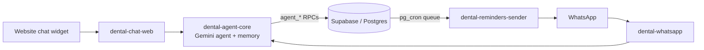

# 🦷 AI Dental Clinic Agent (n8n)

A bilingual (English / Arabic) AI booking assistant for a dental clinic, built in **n8n** with **Google Gemini** and a **Supabase (Postgres)** backend. One shared agent serves several channels: the clinic website's chat widget today, and WhatsApp once a business number is connected.

It was built for **Demo Dental**, a spec demo clinic in Amman, Jordan. The clinic, its dentists and its prices are fictional test data.

- 🌐 Live demo site (with the chat widget): https://demodental-jo.vercel.app

---

## 🧩 Workflows

| Workflow | What it does | Status |
|----------|--------------|--------|
| [`dental-agent-core`](workflows/dental-agent-core.json) | The shared AI agent (Gemini + 12-message memory). Six tools: list services, check availability, book, list my appointments, reschedule, cancel. Each tool calls a secured Supabase RPC. Logs every patient and agent message for the clinic's CRM inbox. | 🟡 Published. Booking tools are waiting on the final API-key hookup |
| [`dental-chat-web`](workflows/dental-chat-web.json) | Website chat adapter. A Chat Trigger receives the widget's messages, normalizes them (session, text, language), hands them to the core agent and returns the reply. CORS is limited to the clinic's domains. | ✅ Live on the demo site |
| [`dental-whatsapp`](workflows/dental-whatsapp.json) | WhatsApp adapter. Accepts text messages only, uses the sender's Meta-verified number as the patient identity, runs the core agent and replies on WhatsApp. | 🟠 Built. Needs WhatsApp Business credentials |
| [`dental-reminders-sender`](workflows/dental-reminders-sender.json) | Appointment reminders and recalls. No AI in this path. Every 15 minutes it claims due messages from a Postgres queue (with a lease token), sends them, and marks each one sent or failed. | 🟠 Built. Needs WhatsApp Business credentials and a Meta-approved template |

---

## 🔐 Design decisions

- **The model never supplies identity.** The adapter sets the patient's identity (`channel` + `external_id`), never the LLM. On the web it is a random browser session ID (stored only as a hash); on WhatsApp it is the Meta-verified sender number. The agent can only see and change that person's own bookings.
- **The database is the security boundary.** Every tool calls a Postgres `SECURITY DEFINER` function that is fixed to one clinic and re-checks the patient's scope on the server. A secret header held in an n8n credential gates them.
- **No hallucinated bookings.** The prompt forbids inventing times, references or clinic facts. If the tools are down, the agent sends the patient to the booking page instead.
- **Safe medical boundaries.** No diagnosis or medical advice. Urgent symptoms are pointed to emergency care.
- **Bilingual by default.** The agent replies in the patient's language, with Jordanian-friendly Arabic and 12-hour times (ص / م).
- **Reminders are deterministic.** Postgres renders fixed bilingual templates and n8n only delivers them, so the reminder path contains no AI.

---

## 🛠️ Import and set up

1. In n8n, go to **Workflows → Import from file** and import the four JSON files from [`workflows/`](workflows/).
2. In `dental-chat-web` and `dental-whatsapp`, point the **Run Dental Agent** node to your imported `dental-agent-core`. This replaces `REPLACE_WITH_DENTAL_AGENT_CORE_WORKFLOW_ID`.
3. Replace `YOUR_PROJECT_REF` and `YOUR_SUPABASE_PUBLISHABLE_KEY` in the HTTP nodes with your Supabase project's values.
4. Create and attach the credentials:
   - **Google Gemini** API credential on the `Gemini` node
   - A **custom auth** credential that sends the `x-dental-agent-key` header on every HTTP node
   - **WhatsApp** credentials, for the WhatsApp and reminder workflows
5. Set `allowedOrigins` on the Chat Trigger to your own website's domain.

> The Supabase schema and `agent_*` functions belong to the clinic app's private repository, so they are not included here.

---

## 🧰 Stack

> **No secrets in this repo.** API keys, credential IDs, project URLs and webhook IDs have all been replaced with placeholders.
